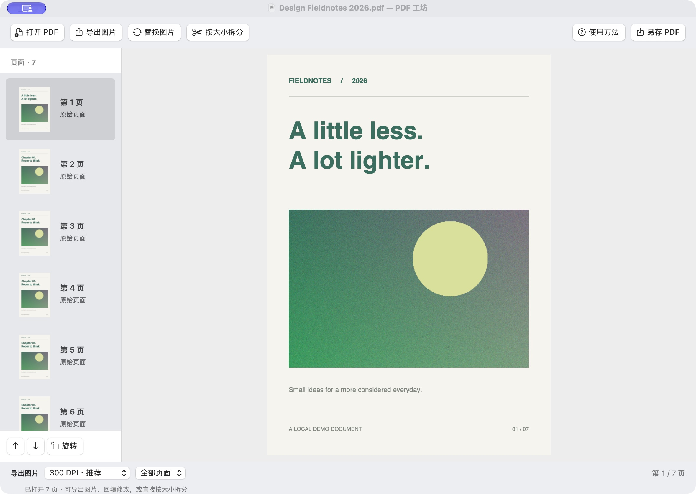

# PDF 工坊 · PDF Workshop

一个原生、离线的 macOS PDF 工具：把 PDF 转成高清图片、将修改后的图片放回页面，再按文件大小拆分。无需上传文件，无第三方运行依赖。

  



## 下载

在 [Releases](https://github.com/litefreeteam/pdf-workshop-macos/releases/latest) 下载 `PDFWorkshop-macOS.zip`，解压后将「PDF 工坊.app」拖入「应用程序」。通用包包含 Apple Silicon 和 Intel 架构。

应用采用本地临时签名，尚未经过 Apple Developer ID 签名和公证。如果 macOS 阻止打开，请在尝试打开后前往「系统设置 → 隐私与安全性」对该应用选择「仍要打开」。

## 功能

| 功能 | 说明 |
| --- | --- |
| PDF → PNG | 150 / 300 / 600 DPI，导出全部页面或仅当前页 |
| 图片回填 PDF | 单张替换当前页，多张按 `page-0001.png` 等页码匹配；确认映射后再替换 |
| 页面整理 | 顺时针旋转、前移或后移，保留当前修改状态 |
| 另存 PDF | 默认新文件名，避免覆盖原文件 |
| 按大小拆分 | 5 / 10 / 20 / 50 MB 预设，或自定义上限；按实际落盘字节数校验 |
| 编辑后直接拆分 | 无需先另存，拆分包含当前图片替换、旋转与页序调整 |
| 本机处理 | 密码解锁、后台导出、拆分进度与取消；无网络请求、遥测或上传 |

### 图片修改流程

1. 打开或拖入 PDF，选择 DPI，点击「导出图片」。
2. 在系统「预览」、Photoshop 等外部工具中修改并保存 PNG。
3. 回到本应用，选中目标页并点击「替换图片」。批量回填时保留导出文件的页码名称。
4. 点击「另存 PDF」，或直接点击「按大小拆分」。

单张图片始终替换当前选中的页面。批量图片无法识别页码时，会显示自然排序与连续替换的对应关系，必须核对后确认。调整页序后请重新导出，再按新页码回填。

### 按大小拆分

点击工具栏「按大小拆分」，设置每份上限、选择输出目录并开始。每次会建立独立目录，文件名包括份号与当前文档页码，不覆盖已有结果。

- 1 MB = 1,000,000 字节；自定义范围为 0.01–100,000 MB。
- 保留完整页面及当前顺序，不对页面主动进行有损压缩或栅格化。
- 采用实际序列化的数据大小决定切点，每份重新打开校验页数与字节数。
- 如果单页单独导出仍超限，提示该页与实际大小，并清理整次任务的不完整结果。
- 取消在当前 PDFKit 操作结束后生效；全部校验成功后才生成最终目录。
- 页面资源共享会影响体积，结果不承诺全局最少份数。

## 开发与构建

需要 macOS 13+，Swift 5.9+ 和 Apple Command Line Tools 或 Xcode。

```bash
# 本机运行
swift run PDFWorkshop

# 自动检查（不依赖 XCTest，也可在 Command Line Tools 环境运行）
swift run -c release WorkshopChecks

# 构建 Apple Silicon / Intel 通用 App、ZIP 及 SHA-256 校验文件
bash build.sh ./dist

# 仅构建当前架构以便快速调试
ARCHS=arm64 bash build.sh ./dist
```

`BUILD_WORK_DIR` 可指定构建缓存位置。Xcode 可直接打开 `Package.swift`。公开分发的 Developer ID 签名和公证需自行配置。

### 项目结构

- `Sources/WorkshopCore`：PNG 导出、图片回填、文档快照与大小拆分引擎。
- `Sources/PDFWorkshop`：原生 AppKit 界面与拆分面板。
- `Tests/WorkshopChecks`：图片方向/尺寸、回填、编辑后拆分、大小边界、页序、源文件保护、取消清理、密码等检查。
- `Resources`：应用信息与可重建的图标。

`docs/ci-build.example.yml` 提供 macOS 检查、通用包构建与标签发布的 GitHub Actions 示例。需要自动构建时，将它复制到 `.github/workflows/build.yml`，并使用具有 workflow 写入权限的凭据提交。本仓库当前由命令行完成本地验证、构建和发布，不依赖启用 Actions。

## 使用边界

- 图片修改在外部软件完成，不包含 OCR、绘画编辑器、单页内部切割或 PDF 压缩。
- 增加 DPI 不会恢复扫描件中已经缺失的细节；页面过大时会提示降低 DPI。
- 图片替换保留当前页面的显示物理尺寸，等比例居中并补白；替换页会变成图片页面。
- 加密 PDF 需正确密码且具备打印、复制及组装权限。输出副本不设密码，密码不写入磁盘配置。
- PDFKit 重写后数字签名不再有效，文档级书签、附件、复杂表单和跨文件链接不保证保留；PNG 导出也不保证包含所有注释叠加层。不适合要求保留这些结构的归档用途。
- 大文档需要足够的内存和磁盘空间。进程强制退出可能留下系统临时目录，正常取消会清理任务输出。
- Apple Silicon 已进行本机验证；Intel 为交叉编译，未在 Intel 实机测试。macOS 13 是最低部署目标，未逐个验证所有系统版本。

## 许可证

[MIT](LICENSE)。欢迎提交问题与改进。
